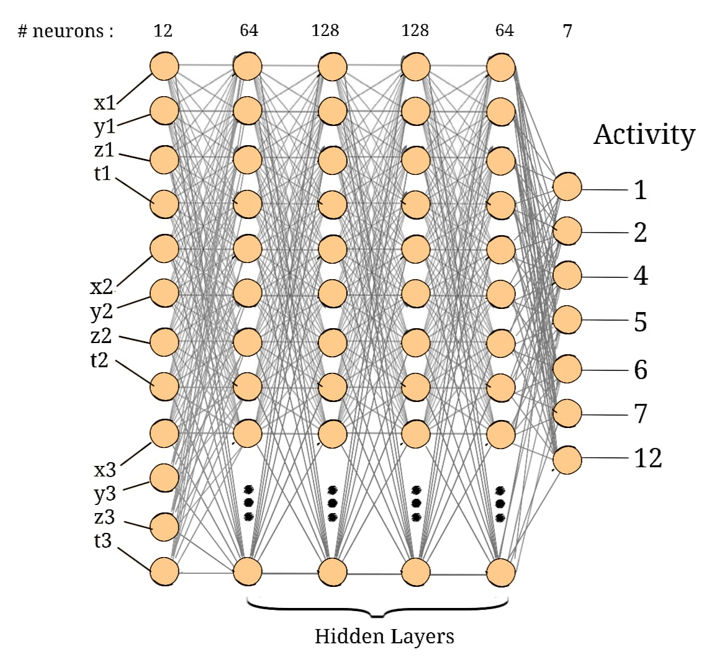

# CSE465_Spring2025_Group-4
Project for CSE465 on 'Nurse Care Activity Recognition' using Machine Learning.



## Team Contributions

| Name                                      | Email                              | Contact No.   | Contribution         |
|-------------------------------------------|------------------------------------|--------------|----------------------|
| Abdullah Mohammad Muntasir Adnan Jami     | abdullah.jami@northsouth.edu      | 1612109658   | [Senior Developer] (10)|
| Hasan Bin Omar                            | hasan.omar@northsouth.edu         | 1301769242   | [Junior Developer] (05)|
| Abrar Ur Alam                             | abrar.alam@northsouth.edu         | 1733387871   | [Junior Developer] (85)|

## Data Augmentation Technique

The dataset is augmented using **noise addition, and scaling** to increase variability and improve model generalization.

1. **Adding Noise**:  
   - Gaussian noise (**mean = 0**, **std = 0.10**) is added to sensor readings.

2. **Scaling**:  
   - Each sensor value is multiplied by a random scaling factor in the range **(0.94, 1.06)** to introduce slight variations in magnitude.

We merged the original dataset with the augmented one for training.

## 5-fold cross validation result
| Metric                | Average Accuracy | Average Precision | Average Recall | Average F1-Score |
|-----------------------|------------------|-------------------|----------------|------------------|
| Value                 | 81.49            | 80.52             | 81.49          | 80.79            |


## Running the new baseline pipeline

The raw-data pipeline is implemented in `pipeline.py`. The original notebook and `test_script.py` remain historical references; their model paths have not been repaired or verified. The new baseline uses window statistics and random forests, with a majority-class reference. It does not depend on the supplied legacy model files.

Run these commands from the project directory in PowerShell:

```powershell
python -m venv .venv
.\.venv\Scripts\python -m pip install -r requirements.txt
.\.venv\Scripts\python pipeline.py prepare
.\.venv\Scripts\python -m unittest test_pipeline -q
.\.venv\Scripts\python pipeline.py train
.\.venv\Scripts\python predict.py --windows outputs/windows.csv
```

Preparation and preprocessing tests use only the Python standard library and were run with Python 3.13.3. Training and prediction require the packages in `requirements.txt`; their execution has not yet been verified because package downloads were blocked in the development environment. The dependency ranges are provisional until training has been run successfully.

Preparation writes `outputs/windows.csv` and `outputs/audit.json`. It uses non-overlapping 2-second windows, requires at least 10 samples, and rejects gaps longer than 0.25 seconds, including gaps at the window edges. These are initial settings, not tuned parameters. Readings are not resampled. Full windows must fit inside one unambiguous labeled interval. Identical timestamps are deduplicated; conflicting readings at the same timestamp are excluded.

UTC recording days serve as session groups because explicit session IDs are unavailable. Days connected by the same labeled interval stay together. The earliest groups form training data; approximately 20% of groups each are reserved for validation and test. These percentages refer to groups, not window counts. The split remains fixed during model comparison.

Training compares a majority predictor and weighted and unweighted random forests using validation macro F1. It saves the selected model and preprocessing metadata to `outputs/baseline.joblib`, and metrics and confusion matrices to `outputs/metrics.json`. Macro F1 includes all observed classes, even those absent from a split; per-class support must be read alongside the aggregate score. Prediction accepts prepared feature windows, not raw sensor streams. Repeated training runs evaluate the test set again, so use a separate development output directory when tuning after the first final evaluation.

### Initial user 4 data audit

A dependency-free CPU benchmark is also available:

```powershell
python benchmark_local.py
```

This fits a standardized nearest-centroid classifier and a majority-class reference using the fixed splits. It writes `outputs/local_benchmark.json` and `outputs/centroid_model.json`; it is separate from the planned random-forest comparison. On a Ryzen 5 5600H system, the full run took approximately 0.51 seconds, with 0.30 seconds spent fitting and a peak process working set of 61.8 MB. The selected centroid model achieved only 5.70% test accuracy and 0.0345 macro F1 across all seven observed classes. This is a resource check and a weak baseline, not a successful recognition model. The random forest has not yet been run because its dependencies could not be downloaded. These test results have now been inspected; subsequent tuning must use validation data and requires a fresh final holdout for an unbiased final report.

| Check | Result |
|-------|--------|
| Raw readings | 12,625,774 |
| Recording coverage (UTC) | November 30, 2018 to January 1, 2019 |
| Label intervals for user 4 | 165 total; 14 zero-length intervals excluded |
| Readings inside multiple label intervals | 139,641 excluded |
| Readings matched to exactly one interval | 305,068 before deduplication |
| Duplicate timestamps within matched intervals | 64,666; no conflicting values found |
| Usable windows | 10,938 |
| Training / validation / test windows | 8,685 / 44 / 2,209 |

The chronological validation and test sets contain only activities 4 and 5. Training includes activities 1, 2, 6, 7, and 12 as well, but activity 2 has only one window and activity 6 has six. This holdout cannot establish recognition performance for the missing classes. Additional recordings and labels are needed before reporting a complete activity-recognition result. The audit also records unmatched readings, rejected full-window candidates, class counts, label-row exclusions, and source-file SHA-256 hashes. Unmatched recordings remain unlabeled.

Raw recordings, generated outputs, and the local virtual environment are ignored by Git. Keep downloaded CSVs in the project directory or supply `--raw` and `--labels`; use `--output` to keep experiments in separate directories.

## Improvement Plan

The next version will rebuild training from the raw accelerometer recordings and activity intervals. The first priority is a reproducible evaluation; model changes will be compared using the same data splits. The results above are the original baseline, not results from the planned work.

### Available data

| File | Contents | Planned use |
|------|----------|-------------|
| `raw_field_acc_user04.csv` | User 4 accelerometer readings with timestamps | First version of the raw-data pipeline |
| `field_label_train.csv` | 1,477 labeled intervals across six users, including 165 intervals for user 4 | Assign activities to matching recordings by user and time |
| `bigact_raw_lab_acc.csv` | Timestamped laboratory accelerometer readings | Inspect separately and locate matching labels before including in training |
| `Augmented_data/` | Existing processed training and test data | Reproduce the previous experiment where possible |

The field label file contains more users than the downloaded field recording. Training across participants requires their corresponding raw recordings. Laboratory and field data will remain separate until their activity definitions, sensor units, and recording conditions have been checked.

### 1. Repair and reproduce the current baseline

- Add a dependency file and document the supported Python version and setup commands after checking compatibility.
- Fix the training and prediction paths. The notebook currently reads `combined_trainset.csv` and saves `best_model.h5` and `scaler.joblib`, while the supplied artifacts include `best_model.keras` and `full_scaler.joblib`. Verify which preprocessing objects belong to each model before using them together.
- Move reusable preprocessing, training, and evaluation code into scripts. Keep the notebook for inspecting data and results.
- Set random seeds and save the configuration, data split, class mapping, and metrics for each experiment.

Completion: a documented command can train a baseline and another command can evaluate its matching saved artifacts on held-out data.

### 2. Build labeled windows from raw data

- Parse recording timestamps and label boundaries as timezone-aware values, then convert both to the same timezone.
- Sort readings by user and time. Check duplicate timestamps, missing values, sampling intervals, long gaps, and overlapping or conflicting labels.
- Match readings to labeled intervals using both user ID and timestamp. Leave unmatched readings unlabeled rather than assigning an activity by default.
- Estimate the sampling rate from each recording before choosing a resampling rate. Do not interpolate across long gaps or recording boundaries.
- Start with 2-second windows and compare 1- and 5-second windows using validation data. Keep windows within a single labeled interval and continuous recording; record how much data this excludes.
- Report readings, recording duration, valid windows, and class counts for every participant and split. Check whether timestamp features in the old data encode session or activity order before carrying them forward.

Completion: a repeatable preprocessing command produces labeled windows and a data-quality report with explicit exclusion counts.

### 3. Prevent leakage and define evaluation

- Assign whole recording sessions or labeled intervals to training, validation, and test sets before generating windows or augmented samples. Related windows from one interval must remain in the same split.
- For user 4, use a chronological session holdout where recording coverage permits. Report the dates and class coverage of each split. Do not claim performance on unseen participants from this experiment.
- Once recordings for multiple participants are available, evaluate with participant-held-out splits. Use leave-one-participant-out evaluation when feasible; limit the number of folds to the available groups.
- Fit scaling and feature selection on the training partition only. Apply augmentation only to training data, preserving the original validation and test recordings.
- Use validation results to select window length, features, augmentation, and model settings. Evaluate the chosen configuration on the final test set once.

Completion: saved split identifiers show that no session or interval crosses partitions, and preprocessing checks confirm that validation and test data never enter fitting or augmentation.

### 4. Address class imbalance

Activities 4 and 5 account for about 89% of the existing augmented training rows. Several other activities have very few examples, so accuracy alone can hide poor recognition of those classes.

- Use macro F1 as the main comparison metric. Also report accuracy, weighted F1, balanced accuracy, per-class precision and recall, support, and a confusion matrix.
- Calculate class weights from the training split and compare weighted and unweighted training.
- Compare the current noise and scaling augmentation against training without augmentation. Apply transformations to acceleration channels only, leaving timestamps and labels unchanged.
- Report classes that are absent from a split or have too few independent intervals for reliable evaluation. Collect more examples where possible rather than treating augmented copies as new independent observations.

### 5. Compare models in stages

| Stage | Model | Inputs and purpose |
|-------|-------|--------------------|
| Reference | Majority-class predictor | Establish the minimum useful performance |
| Feature baseline | Random forest | Window statistics such as mean, standard deviation, range, signal magnitude, and energy |
| Existing approach | Dense ANN | Standardized window features; establish a comparable version of the current model |
| Temporal model | 1D CNN | Acceleration sequences; learn motion patterns within each window |
| Follow-up | GRU or LSTM | Try only if temporal modeling needs further investigation after the CNN comparison |

Use the same splits and evaluation code for every model. For neural models, use early stopping on validation macro F1, restore the best checkpoint, and compare a small, recorded set of learning rates, batch sizes, and dropout settings. Keep the final test set out of these choices.

Completion: an experiment table reports validation scores, held-out results for the selected model, training time, and model size. Improvements must be measured under the new protocol; they cannot be inferred by comparing directly with the original shuffled cross-validation score.

### 6. Package the selected pipeline

- Save the model together with its scaler, class mapping, expected sensor channels, sampling rate, window length, dependency versions, and training configuration.
- Update prediction to use the same preprocessing as training and check the input shape and missing channels before inference.
- Add focused checks for timezone matching, interval boundaries, split isolation, and loading a model with its preprocessing artifacts.
- Document setup, preprocessing, training, evaluation, and prediction commands once implemented. Include the final confusion matrix and limitations in this README.
- Keep raw recordings out of normal Git commits. Add appropriate ignore rules and document the data source, download steps, and checksums; use external storage or Git LFS if the recordings need to be shared.

### Work order and success criteria

1. Repair the baseline and audit the downloaded data.
2. Implement interval matching, window generation, and fixed evaluation splits.
3. Compare feature models and the ANN, then test the 1D CNN.
4. Evaluate the selected model, package inference, and update the reported results.

The improvement will be considered complete when another team member can reproduce the pipeline, the evaluation has no overlap between related training and test samples, and the selected model improves macro F1 over the reproduced baseline under the same split protocol. If no model improves the score, retain the simpler baseline and document the outcome. Cross-participant claims will wait until recordings from additional users have been evaluated.
